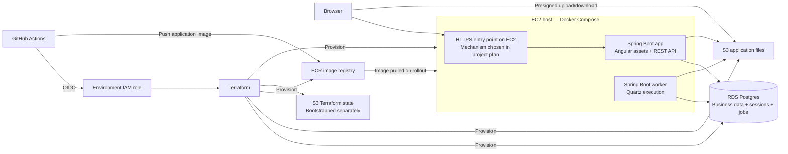
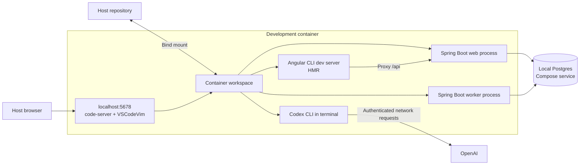

# System Design — Angular, Spring Boot, and AWS

This document explains the intended template architecture. [AGENTS.md](AGENTS.md)
contains the build and deployment rules. The repository currently contains
instructions, not a running application or provisioned infrastructure. Java 21,
Maven, JPA/Hibernate, Flyway, Spring Security, Spring Session JDBC, and Quartz
remain proposed backend defaults pending approval, as recorded in AGENTS.md.
The examples below describe how those defaults would work together.

## The overall architecture

Angular provides the browser interface. Spring Boot serves its compiled files
and the REST API. One production Docker image runs as two Compose services on
EC2: the web application and a background worker. RDS Postgres stores business
data, authentication sessions, and durable job metadata. S3 stores uploaded
files. GitHub Actions builds and deploys the application using temporary AWS
credentials obtained through OIDC.

The diagram distinguishes application traffic from deployment work. Terraform,
ECR, and the state bucket are not part of ordinary API requests. The initial
EC2 topology is one host, so host failure can interrupt both web and worker
services; stateless processes do not by themselves provide high availability.

## Development happens inside Docker

The primary development environment is a dedicated tooling container defined
by `.devcontainer/devcontainer.json`, a supporting Dockerfile, and a Compose
development override. These files are requirements to implement, not files
already present in this template.

The host needs Docker and a browser. The development image contains Java,
Node/npm, Git, Maven Wrapper prerequisites, code-server, Codex CLI, and editor
language tooling. Source code is bind-mounted from the local repository: edits
made in the browser change the files on the host, while compilation, tests,
terminals, and language servers run in the container.

code-server listens on container port 5678 and Docker publishes
`127.0.0.1:5678:5678`. Open `http://localhost:5678` and authenticate using the
local development password. Vim motions come from the preinstalled
`vscodevim.vim` extension. Java and Angular/TypeScript extensions provide
language support. All extension versions and toolchains must be verified and
pinned during implementation.

Angular and Spring Boot use separate development ports; 4200 and 8081 are
examples rather than additional locked decisions. Angular's development
server proxies API requests to Spring Boot, preserving browser authentication
and CSRF behavior. Template and style edits use Angular CLI HMR; application
logic changes may reload the page. Backend rebuild/restart tasks must be
documented separately rather than assuming frontend HMR reloads Java code.

The worker runs with its own Spring profile. Interactive development must not
also launch duplicate packaged app/worker services. A separate packaged-local
Compose mode runs app, worker, and Postgres to exercise the production image.
Production uses RDS and excludes local Postgres and the development container.

Named Docker volumes hold container-native dependencies, Maven caches,
code-server settings/extensions, and the development user's Codex state.
Postgres has its own local data volume. Source code stays in the bind mount;
application files are not silently stored there. Volumes need explicit
ownership and cleanup instructions.

Codex CLI operates on the mounted repository and runs commands using the same
toolchains as the developer. Its CLI runs in Docker, while model inference
requires authenticated network access to OpenAI. Login takes place at runtime,
with device authentication where supported. Credentials are never built into
images or committed. Codex is development tooling, not an application service.

## Angular and Spring Boot serve different responsibilities

Angular implements pages, navigation, forms, and browser interactions using
strict TypeScript and Tailwind CSS. Angular CLI manages development and builds;
there is no separate standalone Vite configuration.

For production, Angular's compiled static files are packaged into the Spring
Boot application. The executable JAR includes an embedded web server, and the
production container needs neither code-server nor an Angular development
server. Node is frontend build tooling, not the production backend.

Spring MVC routes requests to controllers. Request DTOs and Jakarta Bean
Validation check inputs; service methods enforce business rules and transaction
boundaries; Spring Data JPA/Hibernate performs persistence. Response DTOs keep
the API independent of database entity structure.

| Route | Responsibility |
| --- | --- |
| `/api/v1/*` | Versioned application REST API |
| `/api/auth/*` | Application-defined authentication and session endpoints |
| `/healthz` | Deployment health check |
| Frontend routes | Angular assets and appropriate SPA fallback |

Unknown API routes return JSON errors, never Angular HTML. Missing asset
requests also remain missing rather than falling back to `index.html`. Public
list pagination uses one-based `page` and `per_page`; the backend translates
this to Spring Data's zero-based pagination. Errors use
`{ error: { code, message } }`.

## Postgres, migrations, and transactions

Postgres 16 runs in Docker Compose locally and in RDS after deployment. It is
the only application datastore under the proposed defaults: business records,
sessions, and Quartz metadata all persist there. Redis and BullMQ are absent.

Flyway SQL migrations under `src/main/resources/db/migration` define the schema.
JPA entities map it, and Hibernate validates the mappings rather than creating
or changing tables automatically. Migrations also manage Spring Session and
Quartz tables; startup must not recreate or erase those tables.

Related writes belong in service-layer transactions. Indexes support frequent
queries, and deliberate fetch strategies avoid N+1 queries. Open Session in
View is disabled, so API responses load their required data within explicit
transaction boundaries rather than triggering database queries during
serialization.

## Authentication and browser security

Spring Security enforces authentication and authorization. Spring Session JDBC
persists sessions in Postgres, allowing different application instances to
recognize the same session. Passwords use an adaptive password encoder; the
browser receives a session cookie rather than a plaintext password or stored
server secret.

The project must implement and document signup, login, logout, session
inspection, and CSRF-token handling. Password reset, email verification, and
other account flows require explicit scope: Spring Security does not supply a
complete account-management product automatically.

Production session cookies use HTTPS, HttpOnly, and an explicit SameSite policy.
CSRF protection remains enabled for cookie-authenticated writes, coordinated
with Angular's XSRF support and token refresh after login/logout. Native-client
authentication is documented before adding an iOS client; a JWT architecture
is not implicitly included.

## Durable background work

The web process handles requests and submits durable jobs. A separate worker
service, built from the same application image, executes them using Quartz's
Postgres job store. Its worker profile has no HTTP server. The web process does
not execute Quartz jobs.

Recurring jobs and triggers are registered idempotently on worker startup.
Time zones, missed-run behavior, bounded retries, backoff, and terminal failure
status must be defined per job. Quartz provides scheduling and persistence;
application retry policy and business success tracking remain explicit code
and data.

Multiple workers coordinate through clustered Quartz metadata with unique
instance IDs. Job locking does not guarantee exactly-once external effects:
jobs must be idempotent so retries or recovery do not duplicate work.

Creating a record and scheduling its follow-up must not lose work between a
successful database commit and failed job submission. The approved design
must choose a transactional outbox or a verified transactionally coordinated
submission mechanism. Ordinary in-memory asynchronous calls do not satisfy
this durability requirement.

## File uploads and downloads

Deployed files live in S3. The application authorizes a request and returns a
short-lived presigned URL; the browser transfers the file directly to S3.
Postgres stores the object reference and business metadata. Completion and
access rules, allowed types/sizes, retention, and deletion are specified in
the project plan.

Local S3-dependent features are disabled with a clear unavailable state by
default. The template adds no storage emulator or disk-based substitute.
Using AWS for local file testing needs explicit permission and configuration.
The application stays usable locally without AWS credentials.

## What Terraform manages

The application has one flat Terraform root module in the account's default
VPC. Its planned resource scope is:

| Resource | Purpose |
| --- | --- |
| EC2 host | Runs application and worker through Docker Compose |
| Security groups | Control permitted network traffic |
| RDS Postgres and supporting groups | Managed database |
| S3 application buckets | Uploaded files |
| ECR repository | Stores versioned application container images |

Custom VPC networking, ECS, a load balancer, and Terraform child modules require
explicit approval. Domain/DNS, HTTPS termination, runtime AWS permissions, and
the transport used to deliver the Compose bundle to EC2 are decisions in the
project plan, not technologies silently added by this template. The deployment
OIDC role is not automatically the application's runtime identity; runtime S3
access and image-pull access need an approved credential and permission design.

Terraform remote state lives in an existing S3 bucket from its first
initialization, with a distinct state key for each environment. The bucket is
bootstrapped separately by the user or an explicitly authorized local SSO
procedure. Its lifecycle is separate from application Terraform, so destroying
an application does not implicitly destroy its state bucket.

The GitHub OIDC provider and per-environment deployment roles must likewise
exist and pass prerequisite verification. The application build does not
implicitly create them.

## Why GitHub Actions uses OIDC

OIDC authenticates the deployment workflow to AWS without storing long-lived
AWS access keys in GitHub. GitHub issues a short-lived identity token; AWS
checks the token against an IAM role's trust policy and issues temporary
credentials through that role.

The role allows only the exact repository/environment subject
`repo:OWNER/REPO:environment:<env>` and audience `sts.amazonaws.com`.
Each deployment job declares its GitHub Environment and requests
`id-token: write` and `contents: read`. It verifies the expected account and
role before operating on infrastructure.

Terraform describes the resources. The role's permissions authorize AWS
operations. OIDC supplies the temporary authenticated identity used by the
workflow. It is unrelated to end-user application login.

## Deployment and recovery

A requested launch follows this sequence in GitHub Actions:

1. Verify the target environment's prerequisites and required configuration.
2. Test the frontend/backend, compile Angular, and package Spring Boot.
3. Assume the target environment's AWS role through OIDC and verify identity.
4. Initialize remote Terraform state, review the plan, apply approved changes,
   and resolve outputs such as the RDS endpoint and ECR repository.
5. Build and push the application image to ECR.
6. Deliver the Compose bundle and runtime configuration to EC2 using the
   approved transport. Inject secrets at runtime, never into the image.
7. Run Flyway migrations from the approved execution location, preventing
   concurrent migrations. Stop rollout if migrations fail.
8. Activate app/worker services and verify health, signup/login, and creation
   of a designated smoke-test record.

Workflow reruns reuse existing infrastructure. Recovery uses documented image
rollback and migration-compatible releases; switching to an older image is
safe only if it works with the current schema. Teardown is never a recovery
strategy. Transport details, migration execution, HTTPS, and concrete commands
are documented once selected and implemented.

## Configuration, environments, and deletion

Local secrets are stored in gitignored `.env`; a committed `.env.example`
contains placeholders only. Compose passes configuration explicitly to each
service. code-server receives its development password, Codex receives only
its selected authentication configuration, and app/worker receive their own
runtime settings. Spring Boot does not automatically load the repository's
`.env` file.

Deployed secrets come from GitHub Environment secrets and are injected into
EC2 runtime configuration. Each approved environment has a trust-scoped IAM
role, configuration, and environment-specific Terraform state. RDS endpoints
are provisioning outputs, not missing user-supplied pre-provisioning secrets.

Implementation requires an approved project plan and verified prerequisites.
Launch requires a separate user request. Destruction requires confirmation of
the exact environment/resources and an explicit backup decision. Backups must
live outside resources being destroyed. State-bucket deletion needs separate
scope verification, and any remaining GitHub/IAM cleanup must be reported.
